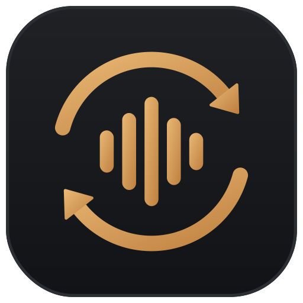
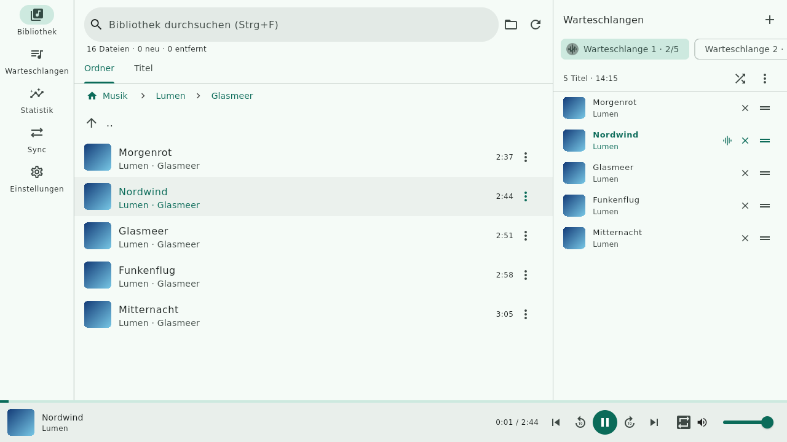
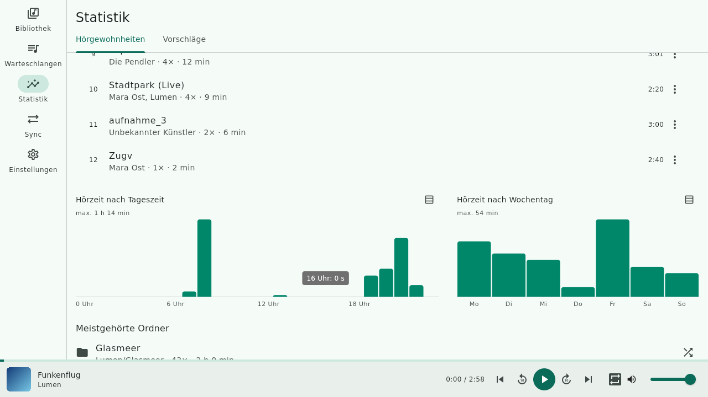
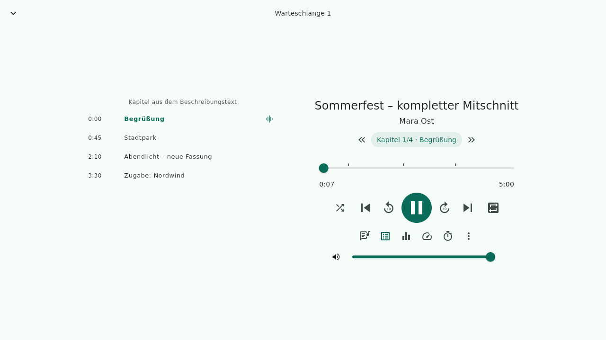

# mync

**mync** = *music sync*. Ein Offline-Musikplayer für Linux im Stil von
Musicolet – plus Synchronisation mit dem Handy, bei der jede Änderung auf
dem Empfängergerät bestätigt werden muss.



| Statistik | Kapitel |
|---|---|
|  |  |

**Was der Player kann:** Abspielen aus Ordnern, **mehrere Warteschlangen**, die
sich ihre Position merken, Zufall, Spulen mit einstellbarer Schrittweite,
**Kapitel** (aus den Tags oder wie bei YouTube aus dem Beschreibungstext) zum
Springen, **Hörstatistik** („diesen Monat am meisten gehört“, Hörzeit nach
Tageszeit) mit **Vorschlägen**, Hörbuch-Positionen je Datei, Überblenden,
**Applaus überspringen** bei Live-Aufnahmen, eine Wellenform-Visualisierung,
Tag-Editor für MP3/FLAC/Ogg/Opus/M4A/WAV inkl. Cover, Umbenennen nach Tags,
synchronisierte Lyrics mit LRC-Editor, Tonhöhe, Balance, ReplayGain,
Sleeptimer, Mini-Player, mehrere Musikordner, Sicherung, Medientasten (MPRIS),
**Sync mit dem Handy** (verschlüsselt, jede Änderung bestätigen) – und
**Teil-Updates** direkt aus den GitHub-Releases. Ohne Konto, ohne Werbung.
Details: [docs/funktionen.md](docs/funktionen.md), Updates: [docs/updates.md](docs/updates.md).

## Installation mit Nix

```bash
nix run github:MrKleeblatt/mync
```

Dauerhaft installieren (mit Eintrag im Anwendungsmenü), auf Wunsch eine
bestimmte Version (`github:MrKleeblatt/mync/v0.6.0`):

```bash
nix profile install github:MrKleeblatt/mync
```

Die Flake im Repository liefert das fertig gebaute Programm aus dem Release
ihrer Version; nixpkgs ist dort in der `flake.lock` festgelegt und beim
Release geprüft. Für NixOS gibt es `nixosModules.default` und
`overlays.default`:

```nix
{
  inputs.mync.url = "github:MrKleeblatt/mync";
  # optional eigenes nixpkgs: inputs.mync.inputs.release.inputs.nixpkgs.follows = "nixpkgs";
  outputs = { nixpkgs, mync, ... }: {
    nixosConfigurations.rechner = nixpkgs.lib.nixosSystem {
      modules = [ mync.nixosModules.default ./configuration.nix ];
    };
  };
}
```

**Updates:** mync meldet neue Versionen selbst („mync 0.7.0 ist verfügbar“)
und zeigt den Befehl dazu (`nix profile upgrade --refresh mync`, bei NixOS
`nix flake update mync` und neu bauen). Selbst installieren kann die
Nix-Variante nicht – das macht Nix.

Grafik: Auf NixOS braucht es `hardware.graphics.enable = true;` (setzt das
Modul), auf anderen Distributionen startet man Nix-Grafikprogramme über
[nixGL](https://github.com/nix-community/nixGL). Auch ohne Repository geht
es direkt aus dem Release-Tarball:
`nix run https://github.com/MrKleeblatt/mync/releases/latest/download/mync-linux-x86_64.tar.gz`.

## Installation unter Arch Linux

```bash
# Build-Abhängigkeiten: Zig 0.17.1 (extra/zig oder AUR) und Flutter (AUR: flutter-bin)
git clone -b docs/konzept https://github.com/mrkleeblatt/mync.git
cd mync/packaging/arch
makepkg -si
```

Danach startet `mync` aus dem Anwendungsmenü oder im Terminal. Beim ersten
Start den Musikordner wählen (Ordner-Symbol oben). Laufzeit-Abhängigkeiten:
`mpv` (libmpv), `gtk3`, `mimalloc`. Zusätzlich wird das Kommandozeilenwerkzeug
`mync-core` installiert (`mync-core scan|status|hash|tag|keygen|sign|verify`).
Danach hält sich mync über die Teil-Updates selbst aktuell (abschaltbar).

## Dokumente

| Dokument | Inhalt |
|---|---|
| [docs/funktionen.md](docs/funktionen.md) | Funktionsstand des Players, Tastenkürzel |
| [docs/updates.md](docs/updates.md) | Teil-Updates: Ablauf, Release veröffentlichen, Signatur |
| [docs/sync-konzept.md](docs/sync-konzept.md) | Konzept für die Synchronisation mit Bestätigung auf dem Empfängergerät |
| [docs/player-plan.md](docs/player-plan.md) | Funktions- und Architekturplan für den Linux-Player |
| [docs/roadmap.md](docs/roadmap.md) | Umsetzungsreihenfolge, Meilensteine, offene Fragen |

## Repo-Struktur

```
mync/
├── app/          # Flutter-App (Dart) für Linux und Android, Kern über dart:ffi
├── core/         # Kern in Zig 0.17.1: Audio-Hash, Tags lesen/schreiben, Dauer,
│   │             #   Manifest, Diff-Engine, CLI `mync`
│   ├── testdata/ # kleine Testdateien aller Formate + erwartete Tags
│   └── vendor/   # SQLite-Amalgamation (C)
├── packaging/    # Arch-PKGBUILD, Startskript, Desktop-Eintrag, Icon
├── tools/release/# Erzeugt Teil-Updates für GitHub-Releases
├── .github/      # Release-Workflow
└── docs/         # Konzepte, Pläne, Funktionsstand, Screenshots
```

## Grundsatzentscheidungen (Kurzfassung)

- **Eine App für beide Geräte:** Flutter (Dart) für die Oberfläche auf
  Linux und Android, darunter ein Kern in **Zig 0.17.1** (`core/`), als
  gemeinsame Bibliothek `libmync_core.so` über `dart:ffi` angebunden.
- **PC:** Player (media_kit/libmpv) + Sync + Inbox.
- **Handy:** Sync-Gegenstelle + Inbox. Abgespielt wird weiter mit Musicolet
  (der mync-Player läuft dort aber ebenfalls).
- **Identischer Kern auf beiden Seiten:** Scanner, Hashes, Tag-Leser,
  Diff-Engine und Sync-Protokoll sind derselbe Zig-Code – beide Geräte
  rechnen garantiert gleich. Abhängigkeiten: nur die Zig-Standardbibliothek
  und SQLite.
- **Kein Cloud-Dienst:** Synchronisation direkt im Heim-WLAN (optional USB/adb).
- **Musicolet bleibt der Player auf dem Handy.** mync-sync arbeitet nur auf den
  Dateien; Musicolet erkennt Änderungen über seinen normalen Rescan.
- **Dateien sind die Wahrheit:** Tags stehen in den Audiodateien (ID3, Vorbis
  Comments, MP4-Atoms), nicht in einer eigenen Datenbank. So bleiben Musicolet
  und mync-player kompatibel.

## Status

- ✅ Zig-Kern `core/` mit Tests (Hashes, Tags lesen und schreiben, Dauer, Manifest, Diff-Engine)
- ✅ Player für Linux und Android (M3, M4, M5), siehe [docs/funktionen.md](docs/funktionen.md)
- ✅ Arch-PKGBUILD
- ✅ Sync mit dem Handy: Kopplung, verschlüsselter Kanal, Inbox, Anwenden (M1, Teile von M2)

## Entwickeln

```bash
# Voraussetzungen: Zig 0.17.1, Flutter; für Android zusätzlich das NDK

# Kern bauen und testen
cd core && zig build test

# Bibliothek einlesen und anzeigen
zig build run -- scan ~/Musik
zig build run -- status ~/Musik

# App starten (Linux) – CMake baut den Zig-Kern automatisch mit; libmpv nötig
cd app && flutter run -d linux

# Fehlersuche: mpv-Fehler und aktive Audiofilter ausgeben
MYNC_DEBUG=1 flutter run -d linux

# FFI-Tests der App gegen den gebauten Kern
cd app && LD_LIBRARY_PATH=../core/zig-out/lib flutter test

# Android-Bibliothek von Hand bauen (Gradle macht das beim `flutter build apk`)
cd core && zig build -Dtarget=aarch64-linux-android.24 -Doptimize=ReleaseSafe \
  -Dandroid-ndk=$ANDROID_NDK_HOME

# Testdateien neu erzeugen (ffmpeg + mutagen nötig, Ergebnis ist eingecheckt)
python3 core/tools/make_testdata.py
```
